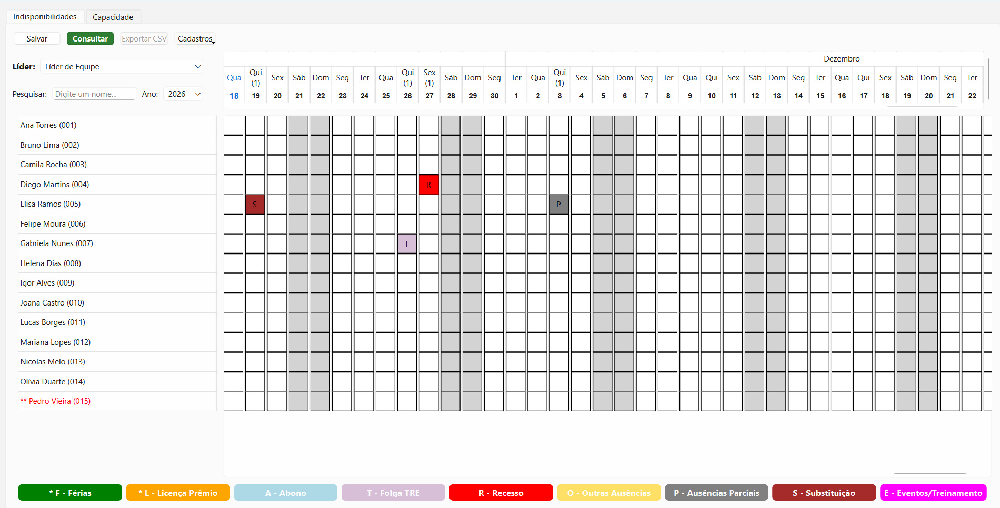

# PGD — Painel de Gestão de Dados

Sistema desktop desenvolvido em **Python e PyQt6** para visualização e gerenciamento de férias e ausências de colaboradores.

Este repositório apresenta uma **versão demonstrativa**, com colaboradores e registros fictícios, baseada em um projeto desenvolvido durante minha experiência de estágio.

## Interface do sistema



## Download da demonstração

**[Baixar PGD para Windows — v1.0.0](https://github.com/jjoaosantoos/pgd-portifolio/releases/tag/v1.0.0)**

Para executar:

1. Acesse o link acima.
2. Na seção **Assets**, baixe o arquivo `PGD.zip`.
3. Extraia o conteúdo do ZIP.
4. Abra o executável do PGD dentro da pasta extraída.

A demonstração funciona localmente, sem conexão com sistemas corporativos. O executável para Windows permite utilizar o programa sem instalar Python, desde que o pacote seja extraído completamente.

## Funcionalidades

- Visualização de férias e ausências em calendário.
- Consulta e filtros de colaboradores.
- Registro de férias e licenças.
- Cadastro de feriados.
- Cadastro de recursos externos.
- Armazenamento local de informações em JSON.
**Observação:** esta versão demonstrativa utiliza
exclusivamente dados fictícios e armazenamento
local em JSON. A exportação CSV está desativada
nesta edição.

## Tecnologias utilizadas

- **Python:** linguagem principal.
- **PyQt6:** interface gráfica desktop.
- **JSON:** persistência local dos registros.
- **Git e GitHub:** versionamento e disponibilização do projeto.

## Executar pelo código-fonte

Requisitos: Windows e Python 3.10 ou superior.

```powershell
py -m venv .venv
.\.venv\Scripts\python.exe -m pip install -r requirements.txt
.\.venv\Scripts\python.exe main.py
```

Os dados da demonstração são armazenados localmente.

## Sobre o projeto

O PGD foi desenvolvido para facilitar a consulta e a organização de informações relacionadas à disponibilidade de colaboradores.

Esta versão foi adaptada para fins de portfólio, utilizando informações fictícias e armazenamento local, sem depender da infraestrutura corporativa.

**Desenvolvedor:** João Victor Santos Rosa
